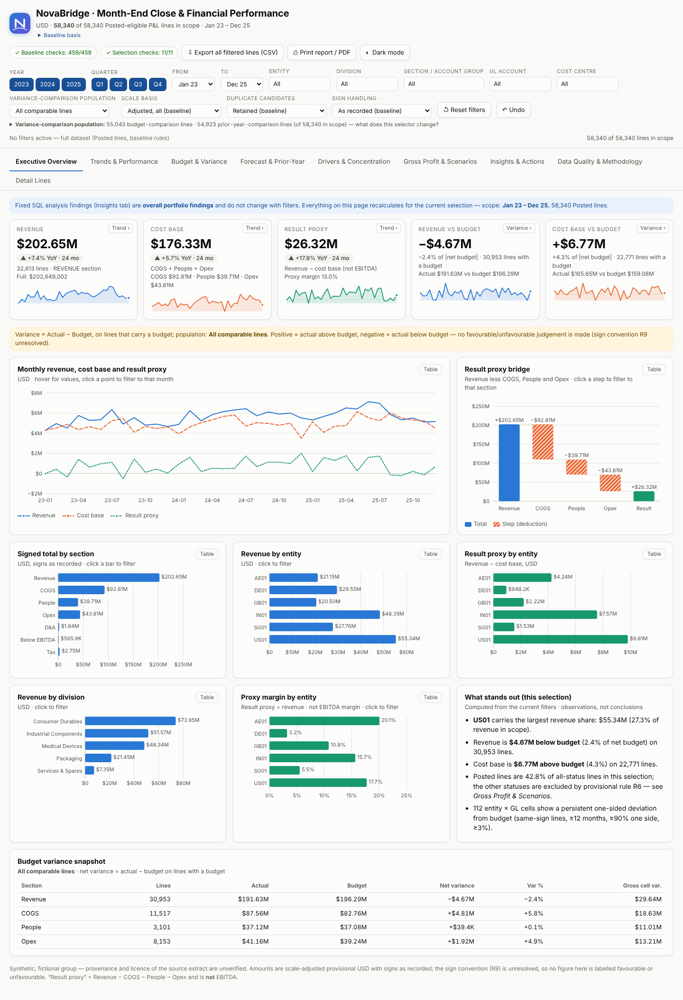
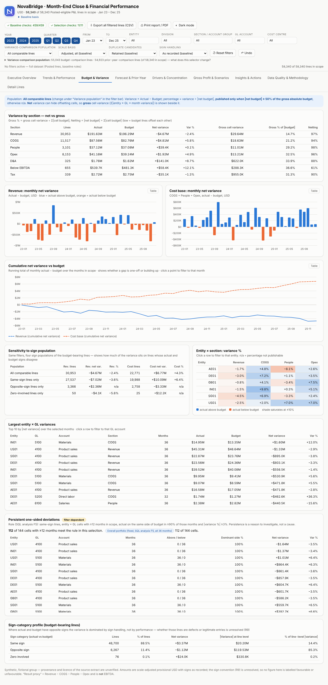
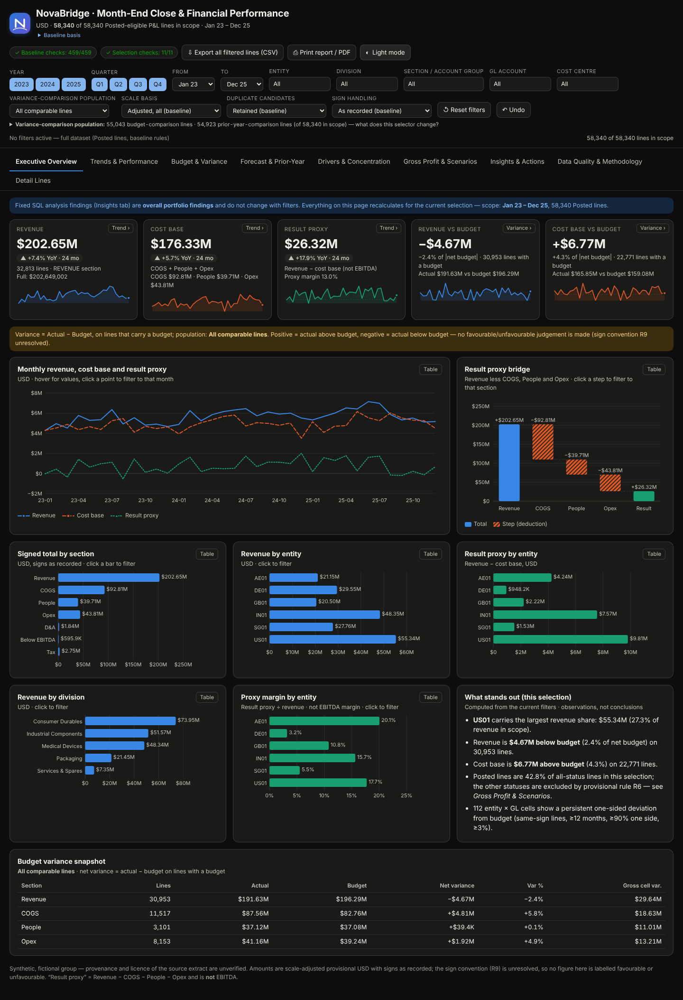

# NovaBridge — Month-End Close Reliability & Financial Performance Analytics

**An end-to-end FP&A analytics portfolio project:** a messy, 152,682-row month-end ledger extract for a fictional group is cleaned without deleting a row, analysed in SQL (DuckDB), reviewed in a formula-driven Excel workbook, explored in an interactive dashboard, and independently re-checked against a pandas recalculation.

> **Portfolio project on synthetic data.** NovaBridge Industries is fictional. I created this synthetic dataset myself for this portfolio project. That is my own statement: no generator script or random seed was kept, so nobody else can independently verify how it was produced. Nothing here describes the performance of a real company, and no figure should be read as one.
>
> **Licence: none.** No open-source licence has been selected and there is no `LICENSE` file. The code and data are visible for review; default copyright applies. This repository is not "open source".

| | |
|---|---|
| **Data** | Raw extract: 152,682 posting lines × 43 text columns · cleaned dataset: same 152,682 rows, 36 months (Jan 2023 – Dec 2025), 6 entities, 5 divisions |
| **Code** | Python (cleaning script, SQL pipeline, cross-check, Excel and dashboard builders), 12 SQL scripts, pytest suites, a dashboard browser-test script |
| **Deliverables** | Cleaned dataset (Excel) · 12-sheet analysis workbook (3,819 formulas) · three reconciliation workbooks · 9-tab standalone dashboard · 11 documents |

---

## Contents

1. [The finance problem](#the-finance-problem)
2. [What the analysis shows](#what-the-analysis-shows-synthetic-data)
3. [How the project is organised](#how-the-project-is-organised)
4. [Repository map](#repository-map)
5. [Data](#data)
6. [Data cleaning and validation](#data-cleaning-and-validation)
7. [SQL analysis](#sql-analysis)
8. [Excel workbooks](#excel-workbooks)
9. [Dashboard](#dashboard)
10. [Testing](#testing)
11. [Technologies](#technologies)
12. [Run it yourself](#run-it-yourself)
13. [Assumptions, limitations and open issues](#assumptions-limitations-and-open-issues)
14. [How this was built (AI assistance)](#how-this-was-built-ai-assistance)
15. [Licence and repository notes](#licence-and-repository-notes)

---

## The finance problem

A group's month-end close often arrives as **one extract** with mixed number formats (`1,234.56` next to `1.234,56`), placeholder text (`###`, `#N/A`, `NA`, `null`), inconsistent labels, unreliable scale fields, non-posting subtotal rows, test entities, and journals in different approval states. Adding it up produces a confident but unreliable number.

Before reporting performance, finance has to answer: **how much of this extract is reportable, and how far do the answers move under rules we cannot settle?** This project works through that:

* decide which records count, and give every excluded row **exactly one documented reason**;
* keep the as-reported value beside every adjusted value, and never delete or silently repair a row;
* vary each unresolved rule (journal status, scale, sign, duplicates) one at a time and report how far the headline moves;
* reconcile Python, SQL, Excel and the dashboard against each other, and **investigate differences rather than force them to match**;
* refuse to draw conclusions the extract cannot support.

## What the analysis shows (synthetic data)

These are findings about the synthetic extract, shown to illustrate the method, not about any real business.

* Only **58,340 of 152,682 rows (38.2%)** qualify for the reported P&L under the project's provisional rules.
* The journal-status rule alone moves reported revenue from **$202.65M** (Posted only) to **$471.58M** (all statuses). Stating the population and the rule beside every number is the point of the exercise.
* Seven insights are registered with evidence in [`docs/INSIGHT_REGISTER.md`](docs/INSIGHT_REGISTER.md), covering budget variance, forecast error (WAPE and bias), prior-year comparison, three explicit gross-profit treatments, and cost concentration (Pareto, HHI).
* Several things are deliberately **not** computed because the data cannot support them: no favourable/unfavourable labels, EBITDA, DSO, DPO, working capital, close-duration or forecast-skill metric.

## How the project is organised

The work was done in seven steps, each building on the verified output of the one before:

| Step | What was done | Main deliverables | Where |
|---|---|---|---|
| **1. Scoping and rules** | Wrote down the finance rules, metric definitions and data dictionary before touching the data | Rules register, data dictionary, provenance record | [`docs/`](docs/) |
| **2. Data profiling and cleaning** | Checked the raw file's identity (SHA-256, rows, columns), profiled all 43 columns, and cleaned the data without deleting a row | `clean_fpa_monthly_close.py`, cleaned dataset, QC report | [`data/`](data/), [`src/`](src/) |
| **3. SQL analysis** | Loaded the cleaned data into DuckDB and ran 12 SQL scripts for variance, forecast error, gross profit, cost structure and data-quality scenarios | SQL scripts, pipeline, 72 result tables, analysis report, insight register | [`sql/`](sql/), [`src/`](src/), [`docs/`](docs/) |
| **4. Excel workbook** | Built a formula-driven workbook that ties back to the SQL results with live PASS/FAIL checks | 12-sheet workbook, 137 reconciliation checks, 7 charts | [`excel/`](excel/) |
| **5. Dashboard** | Built a standalone interactive HTML dashboard from the validated results | Nine tabs, filters, scenarios, CSV export, print, light/dark theme | [`dashboard/`](dashboard/) |
| **6. Independent validation** | Rebuilt every headline figure in pandas and compared it with SQL, Excel and the dashboard; logged the issues found | Reconciliation workbooks, issue log | [`excel/`](excel/) |
| **7. Documentation** | Wrote the guides, methodology and risk register | 11 documents | [`docs/`](docs/) |

## Repository map

```
.
├── README.md                    this file
├── HOW_TO_RUN.txt               exact run sequence (Windows / Linux / macOS)
├── requirements.txt             pinned dependencies (Python 3.11+)
├── data/
│   ├── raw/                     original extract (gzip) + checksum README
│   └── processed/               cleaned dataset (Excel), QC_Report.txt, qc_summary.json
├── src/                         cleaning script, SQL pipeline, cross-check, report, Excel and dashboard builders
├── sql/analysis/                12 numbered DuckDB scripts (+ sql/README.md)
├── excel/                       analysis workbook + three reconciliation workbooks
├── dashboard/                   standalone dashboard HTML + screenshots
├── tests/                       pytest suites, dashboard browser tests
└── docs/                        11 documents (data dictionary, metrics, methodology, guides, risks, ...)
```

Generated files (`build/`: DuckDB database, SQL result tables, dashboard test output) are rebuilt by the scripts and are git-ignored.

## Data

| File | Stored as | Notes |
|---|---|---|
| [`data/raw/fpa_monthly_close_raw_messy.csv.gz`](data/raw/) | 11.2 MB gzip | decompresses to 51,938,535 bytes · SHA-256 `a0e6eddd…ff` |
| [`data/processed/fpa_monthly_close_cleaned.xlsx`](data/processed/) | 67.4 MB Excel | `Cleaned_Data` sheet: 152,682 rows × 77 columns, plus 20 documentation sheets |

* The raw gzip is **lossless**: on 30 Oct 2026 it was decompressed and compared with the original, with identical SHA-256 and line count (152,683 lines: 152,682 rows plus a header). Full hashes: [`data/raw/README.md`](data/raw/README.md).
* The raw file is the **original, never-edited** extract. The cleaned workbook is a separate output of the cleaning script.
* **The cleaned workbook shows 77 of the 192 columns the cleaning script produces.** The SQL analysis also needs the flag, raw-copy and scale-adjustment columns, which are in a 174.5 MB CSV (SHA-256 `c184b677…9b47`). That CSV is **not stored** here: running the cleaning script on the raw file regenerates it (step 0 in [`HOW_TO_RUN.txt`](HOW_TO_RUN.txt)). I did this on 30 Oct 2026 from the published raw file: the CSV hash matched exactly, and the regenerated workbook matched the published one in all 21 sheets (including all 152,682 `Cleaned_Data` rows) except the run timestamp and input path.
* **What the synthetic data represents:** a month-end ledger for NovaBridge Industries, a fictional group. Each row is one posting line with actual, budget, forecast and prior-year amounts in separate USD columns; P&L and balance-sheet lines are mixed; `scenario_tag` is noise by design. See the [data dictionary](docs/DATA_DICTIONARY.md) and [provenance record](docs/DATA_PROVENANCE.md).
* **Personal-data check:** the data contains 8 person-like cost-centre owner names (initial + surname) and 8 generic system user IDs; no email address, phone number or URL appears in the columns checked. They are treated as fictional because the group is fictional; that is not proven.

## Data cleaning and validation

[`src/clean_fpa_monthly_close.py`](src/clean_fpa_monthly_close.py) turns the 43-column text extract into a 192-column analytical file **without deleting a row**:

1. **Integrity gate**: checks the input's SHA-256, row and column counts before doing anything.
2. **Amount parsing**: US and European separators, currency marks, brackets, placeholders; ambiguous strings are flagged, not guessed.
3. **Scale restoration**: where `report_scale` is unreliable, a value is restored to full scale only when a direct identity test or a peer comparison supports it, and left *undetermined* otherwise.
4. **Flags, not repairs**: duplicate candidates, FX anomalies and sign anomalies are flagged and retained.
5. **One exclusion reason per row**: an ordered rule list assigns each row its first failed test (non-posting, test entity, balance-sheet line, journal status, unresolvable period, missing actual, undecidable scale) or marks it eligible.
6. **Self-checks**: 43 in-memory and 23 read-back checks (all passed on 30 Oct 2026), plus a row-for-row preservation check.

Methodology: [`docs/DATA_AND_CLEANING_METHODOLOGY.md`](docs/DATA_AND_CLEANING_METHODOLOGY.md) · rules register: [`docs/FINANCIAL_METRICS.md`](docs/FINANCIAL_METRICS.md).

## SQL analysis

Twelve numbered scripts in [`sql/analysis/`](sql/analysis/) define each population once and build, in order: dimensions and views; grain and overview; load validation; **budget variance**; **forecast error (WAPE, bias)**; **prior-year comparison**; **gross profit** under three treatments of a contra-revenue account; **cost concentration** (Pareto, HHI); trend and volatility; balance sheet (kept apart from the P&L); **data-quality scenarios** (status, scale, sign, duplicates); and a structural validation script. [`src/sql_analysis_pipeline.py`](src/sql_analysis_pipeline.py) runs them and fails closed: on any failed validation nothing is promoted. An independent pandas cross-check ([`src/independent_crosscheck.py`](src/independent_crosscheck.py)) recomputes 124 figures. Guides: [`sql/README.md`](sql/README.md), [`docs/SQL_ANALYTICS_GUIDE.md`](docs/SQL_ANALYTICS_GUIDE.md), full results narrative: [`docs/FINANCIAL_ANALYSIS_REPORT.md`](docs/FINANCIAL_ANALYSIS_REPORT.md).

## Excel workbooks

[`excel/fpa_month_end_close_analysis.xlsx`](excel/fpa_month_end_close_analysis.xlsx) has 12 sheets (Start Here, Executive Summary, Monthly P&L, Budget vs Actual, Forecast & Prior Year, Entity & Division, GL & Cost Drivers, Gross Profit, Insights & Actions, Data Quality, Reconciliation & QA, Definitions), 3,819 formulas and 7 charts. Its **Reconciliation & QA** sheet holds 137 live PASS/FAIL formulas that tie the workbook back to the SQL results. It has no pivot tables.

Three further workbooks come from the independent validation: [`financial_reconciliation.xlsx`](excel/financial_reconciliation.xlsx), [`data_lineage_reconciliation.xlsx`](excel/data_lineage_reconciliation.xlsx) and [`issue_log.xlsx`](excel/issue_log.xlsx). Guide: [`excel/README.md`](excel/README.md), [`docs/EXCEL_FINANCIAL_ANALYSIS_GUIDE.md`](docs/EXCEL_FINANCIAL_ANALYSIS_GUIDE.md).

## Dashboard

[`dashboard/fpa_financial_analytics_dashboard.html`](dashboard/fpa_financial_analytics_dashboard.html) is a **standalone 7.3 MB HTML file** (no server, no network, no third-party library) with nine tabs, global filters, journal-status / scale / sign / duplicate scenario selectors, chart cross-filtering, CSV export, print layout and light/dark themes. It embeds 136,330 line-level records.

**To use it: download the file and open it in a browser.** GitHub displays it as source code and does **not** run it; there is no hosted live demo. User guide: [`docs/DASHBOARD_USER_GUIDE.md`](docs/DASHBOARD_USER_GUIDE.md) · screenshots: [`dashboard/screenshots/`](dashboard/screenshots/).







## Testing

Run on **30-31 Oct 2026** on Linux in a **fresh virtual environment built from the pinned `requirements.txt`** (Python 3.13.16, pandas 3.0.5, NumPy 2.4.6, DuckDB 2.0.0; `pip check` clean). The cleaner was re-run in full, the SQL pipeline and the whole pytest suite were run in that environment:

| Check | Result |
|---|---|
| Cleaning script re-run on the published raw file (full run; also regenerated `QC_Report.txt` and `qc_summary.json`) | 43 in-memory + 27 read-back checks, 0 failed; cleaned CSV SHA-256 identical to the reference |
| SQL analysis pipeline on the real data | exit 0; 72 result tables rebuilt, identical to the previous build except for a few wording changes in check labels |
| pytest (SQL pipeline and Excel workbook suites, with the cleaned CSV) | **125 passed, 0 failed, 0 skipped** |
| Excel workbook rebuild | 3,819 formulas, 137/137 reconciliation checks pass |
| Dashboard: headless Chromium browser test script **297 passed, 0 failed**, 1 skipped (screen-reader test, impossible here); covers filters, scenarios, themes, responsive widths, console errors. Run on the dashboard build just before the last rebuild, which changed only 3 bytes of embedded metadata |

**Historical (not re-run as a whole):** an independent pandas reference compared with SQL, Excel and the dashboard: **780 checks executed: 774 PASS, 1 FAIL, 1 BLOCKED, 4 NOT TESTED, plus 43 INFO**. The single FAIL was a defect in the original run instructions (corrected and regression-tested), not in the data or calculations. Issues found are in [`excel/issue_log.xlsx`](excel/issue_log.xlsx). The one-off validation scripts are not part of this repository.

**Continuous integration:** [`.github/workflows/ci.yml`](.github/workflows/ci.yml) runs on every push and pull request: (1) a fast job with the 42 fixture tests, which need no data; (2) a full-data job that decompresses the raw file, regenerates the cleaned CSV, runs the SQL pipeline and the SQL/pipeline pytest suites. It does **not** run the Excel/LibreOffice tests or the dashboard browser tests. Its result is shown on the Actions tab; the checks above were run by hand, not by CI.

**Not tested:** Windows, other Python versions, native Microsoft Excel, Firefox, Safari, screen readers, a physical printer. Tests need the cleaned CSV, which must be regenerated first (see [Run it yourself](#run-it-yourself)).

## Technologies

Python 3.11+ (pandas, NumPy, OpenPyXL, XlsxWriter) · DuckDB and SQL · pytest · HTML/CSS/JavaScript (hand-written dashboard; no framework) · QA only: Playwright with Chromium, LibreOffice (headless). Exact versions are in [`requirements.txt`](requirements.txt). Power BI is **not** used in this project.

## Run it yourself

```bash
git clone https://github.com/kunalkanjwani08-afk/month-end-close-reliability-fpa-analytics.git
cd month-end-close-reliability-fpa-analytics
python -m venv .venv && source .venv/bin/activate        # Windows: .venv\Scripts\activate
pip install -r requirements.txt
gunzip -k data/raw/fpa_monthly_close_raw_messy.csv.gz      # or the Python one-liner in HOW_TO_RUN.txt
python src/clean_fpa_monthly_close.py --output-dir data/processed   # ~4-5 min; regenerates the 192-column cleaned CSV
python src/sql_analysis_pipeline.py                        # ~20 s; exit 0 = every validation passed
python -m pytest tests -q --ignore=tests/test_excel_workbook.py
python src/excel_workbook_builder.py && python -m pytest tests/test_excel_workbook.py -q
python src/dashboard_builder.py                            # rebuild the dashboard HTML
```

`HOW_TO_RUN.txt` has the full sequence, the Windows commands and the known pitfalls. To look without running anything, open the dashboard HTML or the Excel workbooks directly.

## Assumptions, limitations and open issues

* **Provenance:** the dataset was created by me and is synthetic (owner statement, not independently verifiable); no licence applies to the data or the code.
* **Every headline figure is conditional** on provisional rules: the Posted-only journal-status rule, per-row scale restoration, FX direction, the variance-% convention and per-line summing of budget, forecast and prior-year amounts. The account **sign convention**, **duplicate handling** and **consolidation** remain unresolved.
* **4,996 non-Posted lines appear in no dashboard view** (they fail the amount or scale gates); they are counted in the exclusion waterfall and the workbook's Data Quality sheet.
* The account-to-section mapping has not been checked against an authoritative chart of accounts.
* **Sandbox build paths** (for example `/tmp/...`, no personal paths) remain in `QC_Report.txt` and `qc_summary.json`.
* The reconciliation workbooks in `excel/` are results of one-off validation scripts that are not included, so they cannot be regenerated from this repository.
* The full register, with the evidence that would resolve each item, is in [`docs/ASSUMPTIONS_LIMITATIONS_AND_RISKS.md`](docs/ASSUMPTIONS_LIMITATIONS_AND_RISKS.md).

## How this was built (AI assistance)

I (Kunal Kanjwani) set the scope, the finance rules, the analytical requirements, the review of every step and the acceptance decisions, and I required that failures and untested areas be reported. **Claude (an AI assistant made by Anthropic) wrote most of the code and drafted most of the documentation under my direction**; I did not hand-write every line. Deliverables were also cross-reviewed with a second AI tool, and only corrections that held up against the project files were applied. Treat this as an AI-assisted project directed by a finance student, not as a demonstration of unaided coding.

## Licence and repository notes

* **No licence is granted.** No MIT, Apache, GPL or other open-source licence applies; default copyright is retained. Viewing and forking on GitHub is allowed by GitHub's Terms of Service, which does not grant wider redistribution rights.
* Earlier commits contain files that are no longer in the current tree: an uncompressed ~52 MB copy of the raw CSV and a gzip copy of the cleaned CSV. Git history was **not** rewritten, so they remain in history only.
