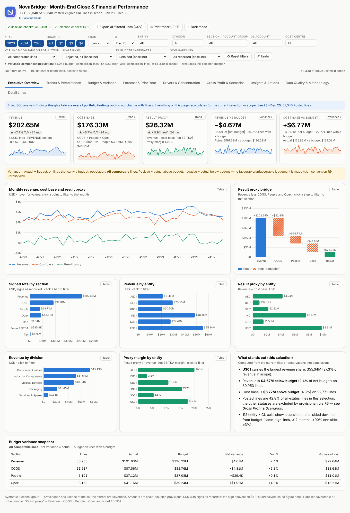
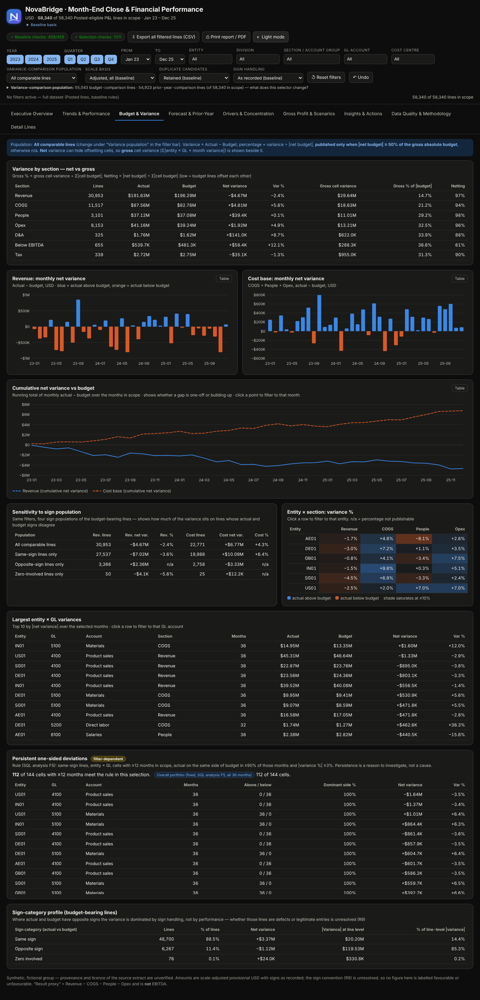
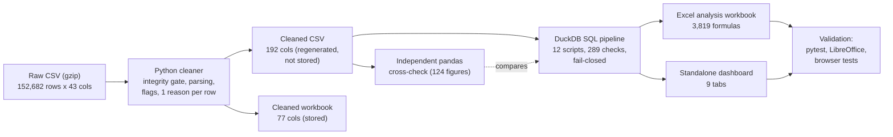

# NovaBridge — Month-End Close Reliability & Financial Performance Analytics

**An end-to-end FP&A analytics portfolio project.** A messy 152,682-line month-end ledger extract for a fictional group is cleaned without deleting a row, analysed in SQL (DuckDB), reviewed in a formula-driven Excel workbook, explored in a standalone interactive dashboard, and independently re-checked in pandas. The central question: *how much of the extract is reportable, and how far do the answers move under accounting rules the data cannot settle?*

> **Synthetic data.** NovaBridge Industries is fictional. The data was created by the project owner (Owner-stated: no generator script or seed was kept, so this cannot be independently verified). Nothing here describes a real company.
>
> **No licence.** No open-source licence has been selected and there is no `LICENSE` file; default copyright applies. The repository is public for review. It is not "open source".





*Screenshots of the standalone dashboard. GitHub shows the HTML file as source code and does not run it: download [`dashboard/fpa_financial_analytics_dashboard.html`](dashboard/fpa_financial_analytics_dashboard.html) and open it in a browser. There is no hosted demo.*

| | |
|---|---|
| **Data** | 152,682 posting lines × 43 text columns in; 192 analytical columns out · Jan 2023 – Dec 2025 (36 months) · 6 entities · 5 divisions · USD |
| **Code** | Python cleaner, DuckDB SQL pipeline (12 scripts), independent pandas cross-check, Excel and dashboard builders, 127 pytest tests, browser tests |
| **Deliverables** | 12-sheet Excel workbook (3,819 formulas, 137 live checks) · 9-tab dashboard · 3 reconciliation workbooks · 11 documents |

## Contents

[Problem and objectives](#problem-and-objectives) · [Project phases](#project-phases) · [Architecture](#architecture) · [Selected findings](#selected-findings) · [Deliverables](#deliverables) · [Repository structure](#repository-structure) · [Quick start](#quick-start) · [Testing and reproducibility](#testing-and-reproducibility) · [Assumptions and limitations](#assumptions-and-limitations) · [AI assistance](#ai-assistance) · [Repository notes](#repository-notes)

## Problem and objectives

A group's month-end close often arrives as one extract with mixed number formats (`1,234.56` beside `1.234,56`), placeholder text (`###`, `#N/A`, `null`), unreliable scale fields, non-posting subtotal rows, test entities and journals in different approval states. Adding it up gives a confident but unreliable number.

Objectives:

1. Decide which records count, and give every excluded row **exactly one documented reason**.
2. Keep the as-reported value beside every scale-adjusted value; never delete or silently repair a row.
3. Vary each unresolved rule (journal status, scale, sign, duplicates) one at a time and report how far the headline moves.
4. Reconcile Python, SQL, Excel and the dashboard against each other, and investigate differences instead of forcing them to match.
5. Decline conclusions the extract cannot support (no EBITDA, DSO, DPO, forecast-skill or favourable/unfavourable labels).

## Project phases

| # | Phase | What was done | Where |
|---|---|---|---|
| 1 | Design and scoping | Wrote the finance rules, metric definitions and data dictionary before touching the data | [`docs/`](docs/) |
| 2 | Data acquisition and profiling | Recorded the file's identity (SHA-256, rows, columns) and profiled all 43 columns | [`data/raw/`](data/raw/) |
| 3 | Python cleaning and validation | 43 → 192 columns, 152,682 rows kept; one exclusion reason per row; 43 in-memory + 27 read-back checks | [`src/clean_fpa_monthly_close.py`](src/clean_fpa_monthly_close.py) |
| 4 | SQL analysis | 12 DuckDB scripts: variance, forecast error, gross profit, cost concentration, data-quality scenarios | [`sql/`](sql/) |
| 5 | Excel analysis and reconciliation | Formula-driven workbook tied to the SQL results by live PASS/FAIL checks | [`excel/`](excel/) |
| 6 | Dashboard | Standalone HTML, nine tabs, filters, scenarios, CSV export, print, light/dark | [`dashboard/`](dashboard/) |
| 7 | Independent QA and cross-validation | pandas recomputation of 124 figures; reconciliation workbooks and issue log | [`excel/`](excel/) |
| 8 | Documentation and reporting | Methodology, metrics, guides, risk register, analysis report | [`docs/`](docs/) |
| 9 | Final repository preparation and publication | Hygiene, CI, reproducibility investigation, public release | this repository |

## Architecture



## Selected findings

All figures: **Posted-eligible population** (58,340 of 152,682 lines, 38.2%), Jan 2023 – Dec 2025, USD, **scale-adjusted amounts**, signs as recorded. They are **provisional** because they depend on rules the owner has not confirmed. Evidence labels are defined in [`docs/README.md`](docs/README.md).

| Finding | Value | Label |
|---|---|---|
| Revenue, Posted journals only | $202.65M (36 months) | Verified (arithmetic); the Posted-only rule is an Assumption |
| Same revenue if every journal status counts | $471.58M (excluding Rejected: $404.38M) | Verified |
| Result proxy (revenue less COGS, People and Opex; **not EBITDA**) | $26.32M, 13.0% of revenue | Verified; definition is an Assumption |
| Revenue vs budget, lines with matching sign | 3.6% below budget; each cost section 6.3–6.4% above, in every month | Verified; reason unknown |
| Gross margin | 54.2%, 51.1% or 54.8% depending on the treatment of sales discounts | Verified; no treatment is declared correct |
| Largest cost items | Materials 36.8% of operating-cost activity; one division 36.1% and one entity 25.8% of the cost base | Verified; described, not judged |
| Scale restoration sensitivity | 6,265 amounts restored; result proxy ranges $25.51M–$29.44M across scenarios | Verified |

Details, formulas and limitations: [`docs/EXECUTIVE_SUMMARY.md`](docs/EXECUTIVE_SUMMARY.md), [`docs/FINANCIAL_ANALYSIS_REPORT.md`](docs/FINANCIAL_ANALYSIS_REPORT.md), [`docs/INSIGHT_REGISTER.md`](docs/INSIGHT_REGISTER.md).

## Deliverables

| Deliverable | File |
|---|---|
| Executive summary | [`docs/EXECUTIVE_SUMMARY.md`](docs/EXECUTIVE_SUMMARY.md) |
| Analysis workbook (12 sheets, 7 charts, 137 reconciliation checks) | [`excel/fpa_month_end_close_analysis.xlsx`](excel/fpa_month_end_close_analysis.xlsx) |
| Interactive dashboard (7.3 MB standalone HTML, 136,330 embedded line records) | [`dashboard/fpa_financial_analytics_dashboard.html`](dashboard/fpa_financial_analytics_dashboard.html) |
| Cleaned dataset (77 of 192 columns, 21 sheets, 65.8 MiB) | [`data/processed/fpa_monthly_close_cleaned.xlsx`](data/processed/fpa_monthly_close_cleaned.xlsx) |
| Reconciliation workbooks and issue log | [`financial_reconciliation.xlsx`](excel/financial_reconciliation.xlsx), [`data_lineage_reconciliation.xlsx`](excel/data_lineage_reconciliation.xlsx), [`issue_log.xlsx`](excel/issue_log.xlsx) |
| SQL scripts and guide | [`sql/README.md`](sql/README.md), [`docs/SQL_ANALYTICS_GUIDE.md`](docs/SQL_ANALYTICS_GUIDE.md) |
| Documentation index | [`docs/README.md`](docs/README.md) |

## Repository structure

```
.
├── README.md                  this file
├── HOW_TO_RUN.txt            step-by-step run guide (Windows PowerShell and Linux)
├── requirements.txt          pinned dependencies
├── .github/                  CI workflow and Dependabot configuration
├── data/raw/                 lossless gzip of the raw extract + checksums
├── data/processed/           cleaned workbook, QC_Report.txt, qc_summary.json
├── src/                      cleaner, SQL pipeline, cross-check, report/Excel/dashboard builders
├── sql/analysis/             12 numbered DuckDB scripts
├── excel/                    analysis workbook + 3 reconciliation workbooks
├── dashboard/                standalone HTML + screenshots
├── tests/                    pytest suites and browser tests
└── docs/                     11 documents + index
```

`build/` (DuckDB database, result tables, test output) and the 174.5 MB cleaned CSV are generated by the scripts and git-ignored.

## Quick start

Python 3.11+ (published results: 3.13.16). About 2 GB RAM and 1 GB disk.

```bash
git clone https://github.com/kunalkanjwani08-afk/month-end-close-reliability-fpa-analytics.git
cd month-end-close-reliability-fpa-analytics
python -m venv .venv && source .venv/bin/activate        # Windows: py -m venv .venv ; .venv\Scripts\Activate.ps1
pip install -r requirements.txt
gunzip -k data/raw/fpa_monthly_close_raw_messy.csv.gz     # Windows: Python one-liner in HOW_TO_RUN.txt
python src/clean_fpa_monthly_close.py --output-dir data/processed   # ~4-5 min; regenerates the 192-column CSV
python src/sql_analysis_pipeline.py                        # ~20 s; exit code 0 = all 289 validation rows passed
python -m pytest tests/test_sql_pipeline_units.py -q       # fast fixture tests
```

The cleaning step overwrites three tracked files with equivalent content and a new timestamp; `HOW_TO_RUN.txt` shows how to restore them with `git restore`. To look without running anything, open the dashboard or the Excel workbooks directly.

## Testing and reproducibility

Run on 31 Oct 2026 on Linux in a fresh virtual environment built from `requirements.txt` (Python 3.13.16, pandas 3.0.5, NumPy 2.4.6, DuckDB 2.0.0; `pip check` clean):

| Check | Result | Automatic in CI? |
|---|---|---|
| Fixture tests (`tests/test_sql_pipeline_units.py`) | 44 passed | Yes |
| Full pytest suite (SQL pipeline, cross-check, Excel workbook) | 127 passed, 0 failed, 0 skipped | SQL part only |
| Cleaner on the published raw file | 43 in-memory + 27 read-back checks, 0 failed | Yes |
| SQL pipeline on the real data | exit 0; 289 validation rows pass; 72 tables | Yes |
| Excel workbook build and QA report | 51 PASS, 0 FAIL; LibreOffice recalculation: 0 mismatches | Manual |
| Dashboard browser tests (headless Chromium) | 295 PASS, 0 FAIL, 2 SKIPPED (optional palette validator; screen reader impossible here) | Manual |
| Dashboard negative controls | 6 of 6 planted defects detected | Manual |

**Reproducibility across CPUs (investigated).** The cleaned CSV is byte-identical to the reference on the reference machine, but on some CPUs it is 73 bytes different. Cause, identified from CI diagnostics: NumPy's `log10` returns last-digit differences on CPUs with and without AVX-512, affecting exactly two of 192 columns (`price_identity_log10_ratio`, `row_log10_magnitude`); the other 190 columns are identical and no calculation or threshold is affected. The pipeline therefore accepts the file only if the exact hash matches, or if a documented *normalised* hash matches (those two columns rounded to 8 significant digits), and it prints a warning in the second case. Any other difference stops the run. Details: [`docs/DATA_AND_CLEANING_METHODOLOGY.md`](docs/DATA_AND_CLEANING_METHODOLOGY.md), section 14.

**Continuous integration** ([`.github/workflows/ci.yml`](.github/workflows/ci.yml)): runs on every push and pull request with read-only permissions, job timeouts and actions pinned to full commit SHAs. Job 1 runs `compileall`, `pip check` and the fixture tests. Job 2 regenerates the cleaned CSV from the raw file, reports whether it matches the reference exactly or only after normalisation, runs the SQL pipeline and the full-data SQL tests. The Excel/LibreOffice and browser steps run only when started manually from the Actions tab and have **not** been executed on a GitHub runner.

**Not tested:** Windows, macOS, Python versions other than 3.13, native Microsoft Excel, Firefox, Safari, screen readers, a physical printer. The one-off scripts behind the reconciliation workbooks are not in this repository, so those workbooks cannot be regenerated from it.

## Assumptions and limitations

* **Every headline figure is conditional** on provisional rules: Posted-only eligibility, per-row scale restoration, FX direction, the variance-percentage convention and per-line summing of budget, forecast and prior-year amounts. The account **sign convention**, **duplicate handling** and **consolidation** are **Unresolved**.
* 4,996 non-Posted lines appear in no dashboard view (they fail the amount or scale gates); they are counted in the exclusion waterfall.
* The account-to-section mapping has not been checked against an authoritative chart of accounts.
* The data is synthetic and its provenance is Owner-stated only; conclusions describe the extract, not any business.
* Full register with the evidence that would resolve each item: [`docs/ASSUMPTIONS_LIMITATIONS_AND_RISKS.md`](docs/ASSUMPTIONS_LIMITATIONS_AND_RISKS.md).

## AI assistance

I (Kunal Kanjwani) set the scope, the finance rules, the review of every step and the acceptance decisions, and required that failures and untested areas be reported. **Claude (an AI assistant made by Anthropic) wrote most of the code and drafted most of the documentation under my direction**; I did not hand-write every line. Deliverables were also cross-reviewed with a second AI tool, and only corrections that held up against the project files were applied. Treat this as an AI-assisted project directed by a finance student, not as a demonstration of unaided coding.

## Repository notes

* **No licence is granted** (see top). GitHub's Terms allow viewing and forking; they do not grant wider redistribution rights.
* The 65.8 MiB cleaned workbook is under GitHub's 100 MB limit but above its 50 MB warning threshold; it is kept in the repository because it is the audited deliverable. Cloning downloads it.
* Earlier commits contain an uncompressed ~52 MB copy of the raw CSV and a gzip copy of the cleaned CSV. History was **not** rewritten, so they remain in history only.
