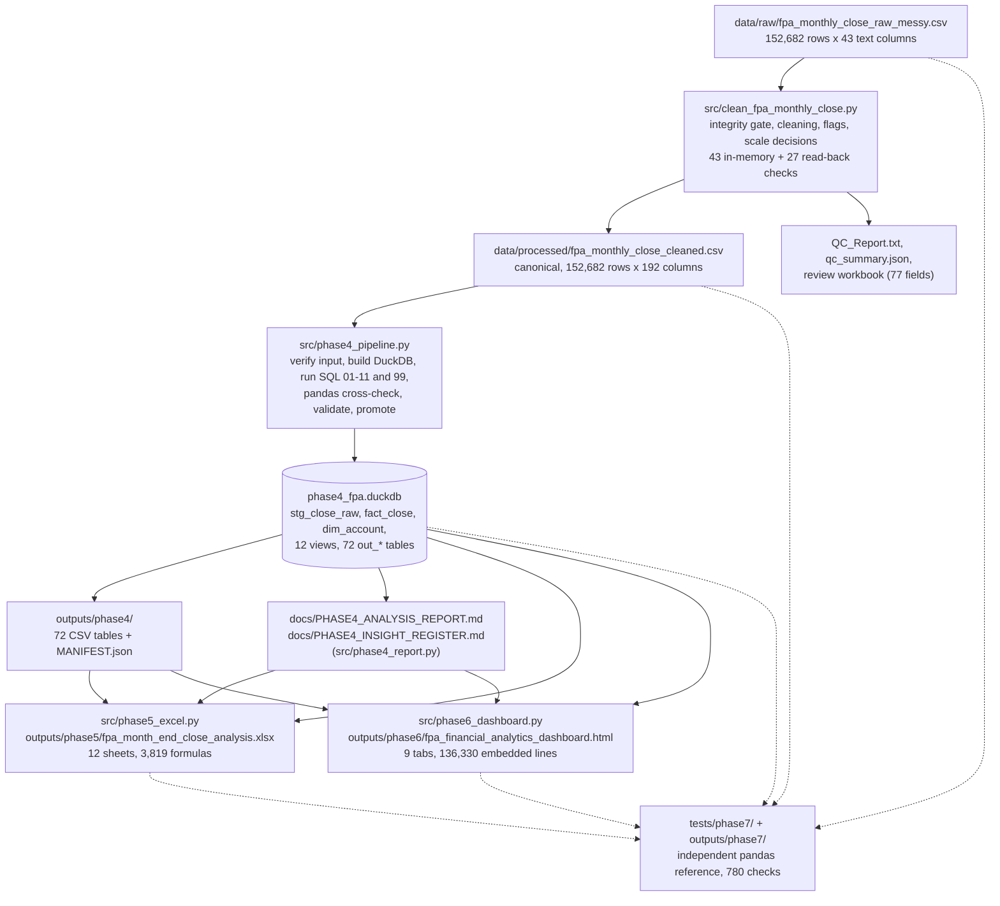

# End-to-End Workflow and Architecture

> **Status (updated at Phase 9 publication, 30 Oct 2026):** published as part of the complete project. The owner decided to publish the whole project, including the dataset he describes as synthetic. Dataset provenance and redistribution rights remain **owner-stated and not independently verified**. Any wording below from Phase 8 that calls the release *blocked*, *draft* or *not approved* describes the Phase 8 state and is superseded by [PUBLICATION_DECISION.md](PUBLICATION_DECISION.md). No calculation, figure or finding was changed.
> **Evidence labels:** **Verified** / **Owner-stated** / **Assumption** / **Unresolved**.

Related: [Project overview](PROJECT_OVERVIEW.md) · [Data and cleaning methodology](DATA_AND_CLEANING_METHODOLOGY.md) · [SQL guide](SQL_ANALYTICS_GUIDE.md) · [File catalogue](PROJECT_FILE_CATALOG.md)

---

## 1. The workflow in one line

Raw financial dataset → Python cleaning and validation → canonical cleaned dataset → DuckDB database → SQL financial analysis → Excel review and reconciliation → interactive HTML dashboard → independent QA and validation.

Each stage is gated: it reads only the verified output of the stage before it, and it refuses to run (or refuses to promote its outputs) if an integrity or validation check fails.

## 2. Architecture diagram

The diagram shows the components that exist in the repository. Dashed arrows are read-only checks.



Phase 4 also has its own tests (`tests/test_phase4_units.py`, `tests/test_phase4.py`), Phase 5 has `tests/test_phase5_excel.py`, and Phase 6 has `tests/phase6_dashboard_qa.py` and `tests/phase6_negative_controls.py`. They are not drawn separately.

## 3. Stage-by-stage description

### Stage 1 — Raw financial dataset

| | |
|---|---|
| **Input** | A CSV supplied by the project owner (Owner-stated: synthetic; provenance not recorded). |
| **Process** | None. The file is never edited. Its identity is fixed by SHA-256. |
| **Output** | `data/raw/fpa_monthly_close_raw_messy.csv`: 51,938,535 bytes, 152,682 data rows, 43 columns, all stored as text. The dataset contains 152,682 source extract records, including 350 non-posting subtotal/check records. These 350 records are not treated as ordinary posted journal lines. This file is tracked in git and present in the public `main` branch (see README, *Repository status*). |
| **Technologies** | CSV. |
| **Validation** | SHA-256 `a0e6eddde25280aa27a60c5955743d3243b14138d876eedac0547e24a1cc6fff`, byte size, row count and column count are re-computed by the cleaner on every run; a mismatch stops the run. |
| **Used by next stage** | Read-only input to the cleaner. |

### Stage 2 — Python cleaning and data validation

| | |
|---|---|
| **Input** | The raw CSV. |
| **Process** | Profile every column; parse five amount columns from many text formats; normalise labels; resolve periods and entities; decide the reporting scale per row; flag duplicate candidates, FX and sign anomalies; assign one primary exclusion reason per scope. **No row is deleted.** |
| **Output** | Canonical cleaned CSV; review workbook; cell-level audit CSV; `QC_Report.txt`; `qc_summary.json`. |
| **Technologies** | Python, pandas, NumPy, openpyxl/XlsxWriter. |
| **Validation** | 43 in-memory checks and 27 read-back checks of the written files, all PASS. Raw file hash re-computed after the run. |
| **Used by next stage** | The pipeline accepts only the canonical cleaned CSV, identified by its SHA-256. |

### Stage 3 — Canonical cleaned dataset

| | |
|---|---|
| **Input** | Stage 2 output. |
| **Process** | None; this is a fixed artefact. |
| **Output** | `data/processed/fpa_monthly_close_cleaned.csv`: 174,545,248 bytes, 152,682 rows, 192 columns, SHA-256 `c184b677bacc6f23086e3b5eedd71836643cb75064e428a1ebfee4c075fa9b47`. |
| **Technologies** | CSV (UTF-8 with a byte-order mark). |
| **Validation** | Row identifiers equal the raw file's, in the same order; the 19 raw-value columns are preserved byte for byte (Phase 7). |
| **Used by next stage** | Loaded in full into DuckDB. |

### Stage 4 — DuckDB database

| | |
|---|---|
| **Input** | The cleaned CSV. |
| **Process** | `phase4_pipeline.py` verifies the file (hash, rows, columns, header fingerprint, 32 required fields), loads it as `stg_close_raw` (all text) and `fact_close` (typed), and builds the account dimension. |
| **Output** | `data/processed/phase4_fpa.duckdb` (86,257,664 bytes in the approved build; generated, not tracked by git). |
| **Technologies** | Python, DuckDB. |
| **Validation** | Row counts and schema against the cleaner's report; one-to-one mapping of the 32 GL accounts. |
| **Used by next stage** | The SQL scripts read it. Later stages open it read-only. |

### Stage 5 — SQL financial analysis

| | |
|---|---|
| **Input** | The database. |
| **Process** | Twelve numbered SQL scripts (`sql/phase4/01…11` and `99`) define views and populations and compute the analyses A–I (overview, variance, forecast, prior year, gross profit, cost structure, trend, balance sheet, data-quality scenarios). |
| **Output** | 72 `out_*` tables exported as CSV with a manifest (row count and SHA-256 per file); the analysis report and the seven-insight register. |
| **Technologies** | SQL (DuckDB), Python. |
| **Validation** | 55 load checks, 24 exclusion checks, 86 analytical re-derivations and 124 independent pandas cross-checks must all PASS before the database and outputs are promoted; on failure nothing accepted is overwritten. |
| **Used by next stage** | The workbook and dashboard are built from these tables and the database views. |

### Stage 6 — Excel financial review and reconciliation

| | |
|---|---|
| **Input** | The validated database, the Phase 4 output tables and manifest, and the insight register. |
| **Process** | `phase5_excel.py` first re-verifies the Phase 4 hand-off (manifest hashes, row counts, every validation row), then writes the workbook. |
| **Output** | `outputs/phase5/fpa_month_end_close_analysis.xlsx` (12 sheets, 22 tables, 7 charts), `MANIFEST.json`, `PHASE5_QA_REPORT.md`. |
| **Technologies** | Python, XlsxWriter, Excel formulas; LibreOffice for independent recalculation in QA. |
| **Validation** | 137 live reconciliation formulas in the workbook; 51 automated tests; all 3,819 formulas recalculated independently with no mismatch. Not opened in Microsoft Excel. |
| **Used by next stage** | The dashboard embeds the workbook's hash for provenance; the workbook and dashboard share populations and definitions. |

### Stage 7 — Interactive HTML dashboard

| | |
|---|---|
| **Input** | The validated database (read-only), the Phase 4 output tables and the insight register. |
| **Process** | `phase6_dashboard.py` exports the eligible lines (58,340 Posted plus 77,990 non-Posted diagnostic lines) into a compact payload and injects it into an HTML template with its style sheet and JavaScript. Aggregation happens in the browser. |
| **Output** | `outputs/phase6/fpa_financial_analytics_dashboard.html`: 7,317,802 bytes, standalone, no network request. |
| **Technologies** | HTML, CSS, JavaScript (hand-written, no third-party library), inline SVG charts, Python build script. |
| **Validation** | 297 PASS / 0 FAIL / 1 SKIP browser checks in Phase 6; 6 of 6 negative controls detected; 471 PASS / 3 NOT TESTED in Phase 7. |
| **Used by next stage** | Tested independently in Phase 7. |

### Stage 8 — Independent QA and validation (Phase 7)

| | |
|---|---|
| **Input** | Raw and cleaned CSVs, database, workbook and dashboard, all read-only. |
| **Process** | A separate pandas reference, which imports no project code, re-parses the raw amounts, re-derives every exclusion reason and rebuilds each metric; results are compared with the SQL outputs, the workbook and 17 dashboard states. Pipeline stages are re-run in isolated copies. |
| **Output** | `outputs/phase7/`: report, three reconciliation workbooks, check registry (`qa_results.json`), SHA-256 manifest, execution logs and evidence. |
| **Technologies** | Python, pandas, DuckDB (read-only), Playwright with Chromium, LibreOffice. |
| **Validation** | 780 checks: 774 PASS, 1 FAIL, 1 BLOCKED, 4 NOT TESTED, plus 43 INFO observations. Negative controls prove the comparisons can fail. |
| **Used by next stage** | The issue log and corrected `HOW_TO_RUN.txt` feed Phase 8. |

## 4. Project folder structure

```
month-end-close-reliability-fpa-analytics/
├── README.md                      documentation  (existing root README; Phase 8 draft is separate)
├── HOW_TO_RUN.txt                 documentation  (corrected in Phase 7)
├── requirements.txt               environment pins
├── .gitignore
├── data/
│   ├── raw/                       DATA   raw extract (never edited; tracked in git, present in public `main`)
│   └── processed/                 DATA   cleaned CSV, DuckDB file (both generated; not tracked by git), QC_Report.txt, qc_summary.json
├── src/                           SOURCE
│   ├── clean_fpa_monthly_close.py        Phase 3 cleaner
│   ├── phase4_pipeline.py, phase4_crosscheck.py, phase4_report.py
│   ├── phase5_excel.py
│   └── phase6_dashboard.py, phase6_report.py, phase6_template.html, phase6_style.css,
│       phase6_core.js, phase6_views.js
├── sql/phase4/                    SOURCE  12 numbered SQL scripts (01-11, 99)
├── outputs/                       ANALYSIS OUTPUTS and evidence
│   ├── phase4/                           72 result tables (CSV) + MANIFEST.json
│   ├── phase5/                           Excel workbook, MANIFEST.json, QA report
│   ├── phase6/                           dashboard HTML, QA report, QA results, screenshots, print preview
│   ├── phase7/                           QA report, 3 reconciliation workbooks, qa_results.json,
│   │                                     file manifest, test_execution_logs/, evidence/
│   └── phase8/                           this documentation package and its QA report
├── docs/                          DOCUMENTATION  Phase 1 and Phase 4/5 documents (the Phase 8 set is drafted in
│                                     outputs/phase8/documentation_package/docs/)
├── tests/                         TESTS
│   ├── test_phase4_units.py, test_phase4.py, test_phase5_excel.py, conftest.py
│   ├── phase6_dashboard_qa.py, phase6_negative_controls.py
│   └── phase7/                           independent QA code (12 modules)
├── dashboard/                     empty placeholder (the dashboard lives in outputs/phase6)
└── .github/workflows/             empty placeholder (no CI exists)
```

Classification: **source files** = `src/`, `sql/`; **data files** = `data/`; **analysis outputs** = `outputs/phase4`–`phase6`; **documentation** = `docs/`, `README.md`, `HOW_TO_RUN.txt`, `outputs/phase8/`; **tests** = `tests/`; **evidence** = `outputs/phase5/PHASE5_QA_REPORT.md`, `outputs/phase6/` QA files, `outputs/phase7/`.

## 5. Checks that run at the boundaries

| Boundary | Check | Failure behaviour |
|---|---|---|
| Raw → cleaner | SHA-256, size, rows, columns | Stops, explains, never substitutes another file |
| Cleaner → files | Read-back of every written file | Reported in `QC_Report.txt` |
| Cleaned CSV → pipeline | SHA-256, rows, columns, header fingerprint, required fields | Exit 1 (missing) or 2 (mismatch); nothing written |
| Pipeline → promotion | Every `out_val_*` row PASS, unique check ids | Exit 2; accepted outputs untouched; diagnostics kept in a `_failed_run` area |
| Phase 4 → workbook | Manifest hashes, row counts, validation rows | Exit 1 or 2; no workbook written |
| Database → dashboard | Read-only; baseline checks recomputed in the page | Badge shows `N / N` baseline checks passed |
| All stages → Phase 7 | Independent recomputation | FAIL recorded in the check registry |
